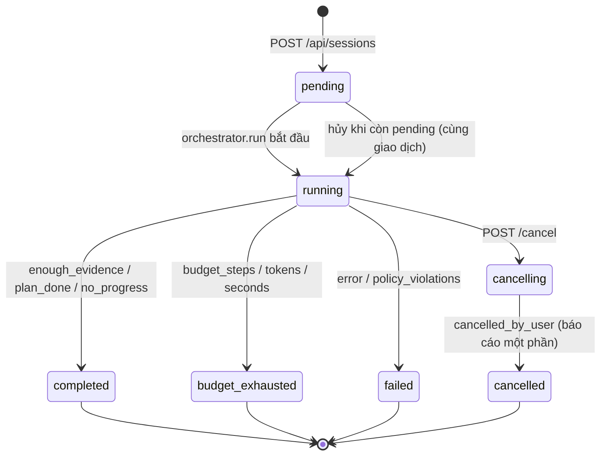

# 01 · Đặc tả yêu cầu

## Mục tiêu
Hệ thống điều phối agent **chỉ đọc**: nhận một câu hỏi tra cứu, lập kế hoạch, gọi công cụ chỉ-đọc trong allowlist, lưu bằng chứng không thể sửa, rồi trả báo cáo có trích dẫn `[E#]`. Phiên nào kết thúc — kể cả bị hủy hoặc lỗi — **đều phải có báo cáo** (phần đã có).

## Yêu cầu chức năng
| Mã | Yêu cầu | Nơi hiện thực | Kiểm chứng |
|---|---|---|---|
| FR-1 | Tạo phiên với giới hạn bước/token/giây | `api/main.py`, `core/models.Limits` | `tests/agent/test_loop_postgres.py` |
| FR-2 | Kế hoạch 3–6 bước lưu trong CSDL | `agent/planner.py`, trigger CSDL | `tests/agent/*` |
| FR-3 | Chỉ chạy công cụ trong allowlist lấy từ CSDL | `guards/tool_policy.py`, `tools/registry.py` | T6 (blocked_policy) |
| FR-4 | Công cụ: `search_documents`, `read_document`, `http_get_api` (GET) | `tools/*` | `tests/tools`, `tests/api` |
| FR-5 | Quét prompt injection; nội dung bị gắn cờ không vào prompt/báo cáo | `guards/injection_guard.py` | `tests/guards`, T5 |
| FR-6 | Bằng chứng append-only, có chuỗi băm SHA-256 | trigger `002`, `evidence/store.py` | `tests/evidence` |
| FR-7 | Báo cáo có `[E#]`, kiểm chứng RAG, fail-closed sang báo cáo trích xuất | `agent/report_synthesizer.py`, `rag/` | `tests/llm` |
| FR-8 | **Hủy phiên ở mọi thời điểm vẫn trả phần báo cáo đã có** | `agent/orchestrator.py`, `db/sessions.py` | T3, T4 |
| FR-9 | Phiên mồ côi (tiến trình chết) được đóng và có báo cáo | `agent/recovery.py` | `test_recovery_postgres.py` |
| FR-10 | Giao diện tạo/xem/hủy phiên, xem bằng chứng và tính toàn vẹn | `frontend/` | build + chạy thử |

## Yêu cầu phi chức năng
| Mã | Yêu cầu | Cách đảm bảo |
|---|---|---|
| NFR-1 | Không có đường ghi từ công cụ | Công cụ chỉ nhận pool vai trò `aik08_reader` (SELECT-only, read-only) |
| NFR-2 | Ràng buộc nghiệp vụ không phụ thuộc mã ứng dụng | Máy trạng thái, ngân sách, báo cáo bắt buộc nằm trong trigger/constraint |
| NFR-3 | Quan sát được | OpenTelemetry: span cho session, kế hoạch, LLM, từng lượt, guard, công cụ, quét, lưu bằng chứng, tổng hợp, kiểm chứng |
| NFR-4 | Bí mật không vào kho mã | `.env` bị loại ở `.gitignore`, `scripts/package.py`; compose dùng `${VAR:?}` |
| NFR-5 | Chạy lại được | Docker compose, migration có checksum, seed cố định |

## Ràng buộc và giả định
- Một tiến trình API (khôi phục mồ côi giả định đơn tiến trình; đặt `RECOVER_ON_START=false` khi nhiều worker).
- API **chưa có xác thực**: chỉ chạy loopback/mạng tin cậy.
- Công cụ HTTP chỉ gọi URL dưới các tiền tố trong `API_ALLOWED_URL_PREFIXES`.

## Trạng thái phiên

