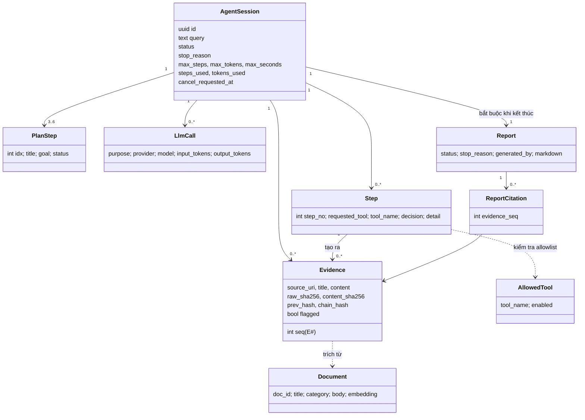

# 02 · Mô hình miền

Lược đồ PostgreSQL `aik08` (SQL thuần, không ORM) là nguồn sự thật; các lớp Python trong `app/core/models.py` phản chiếu nó.

## Bất biến do CSDL bảo đảm
- **Máy trạng thái phiên**: `pending→running`; `running→cancelling|terminal`; `cancelling→terminal`. Mọi chuyển khác bị trigger từ chối.
- **Kế hoạch** 3–6 bước, chèn một câu lệnh; `steps`/`plan_steps` chỉ chèn khi phiên `running`; `llm_calls` nhận trong `running` và `cancelling`.
- `decision = blocked_policy` ⇔ `tool_name IS NULL`; dòng bước chỉ cập nhật `running→executed|tool_error`, nên bước trùng/sai tham số/bị chặn được chèn **đã đóng**.
- **Ngân sách**: số bước/token/giây không vượt giới hạn của phiên.
- **Bằng chứng** append-only: `UPDATE/DELETE/TRUNCATE` bị chặn kể cả với chủ sở hữu; `seq` (E#), băm nội dung và băm chuỗi do trigger tính.
- **Báo cáo bắt buộc** cho mọi phiên kết thúc (deferred constraint trigger); mọi `[E#]` trong báo cáo phải tồn tại (`unknown_citation`).
- Vai trò: `aik08_reader` (SELECT-only, `default_transaction_read_only`, timeout 5 s), `aik08_app` (ghi sổ phiên, không UPDATE/DELETE bằng chứng).

## Từ vựng
| Thuật ngữ | Nghĩa |
|---|---|
| Bằng chứng (Evidence) | Một mục lấy từ công cụ, có nhãn `E#` theo thứ tự phiên |
| Gắn cờ (flagged) | Có dấu hiệu prompt injection: nội dung bị ẩn khỏi prompt/báo cáo trích xuất |
| Báo cáo trích xuất | Báo cáo dự phòng chỉ gồm trích đoạn bằng chứng, không qua LLM |
| Mồ côi (orphan) | Phiên còn `pending/running/cancelling` nhưng tiến trình xử lý đã mất |
