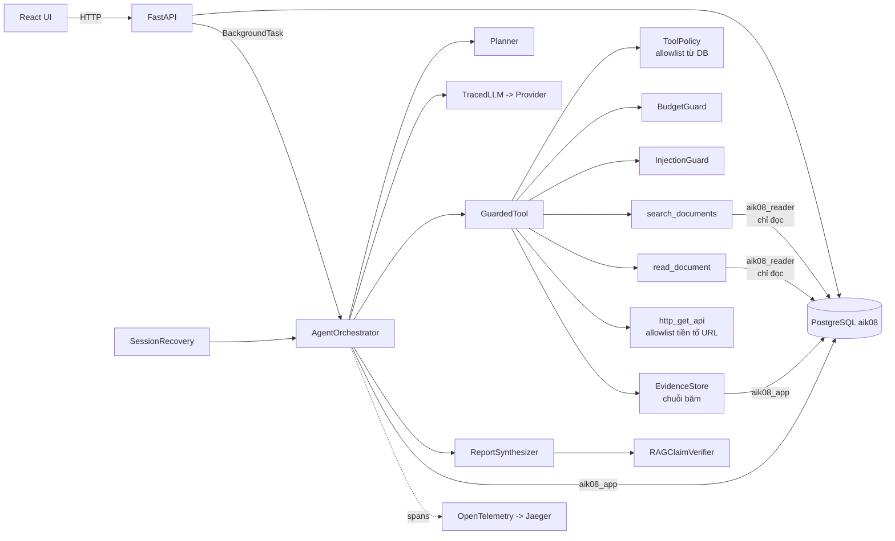
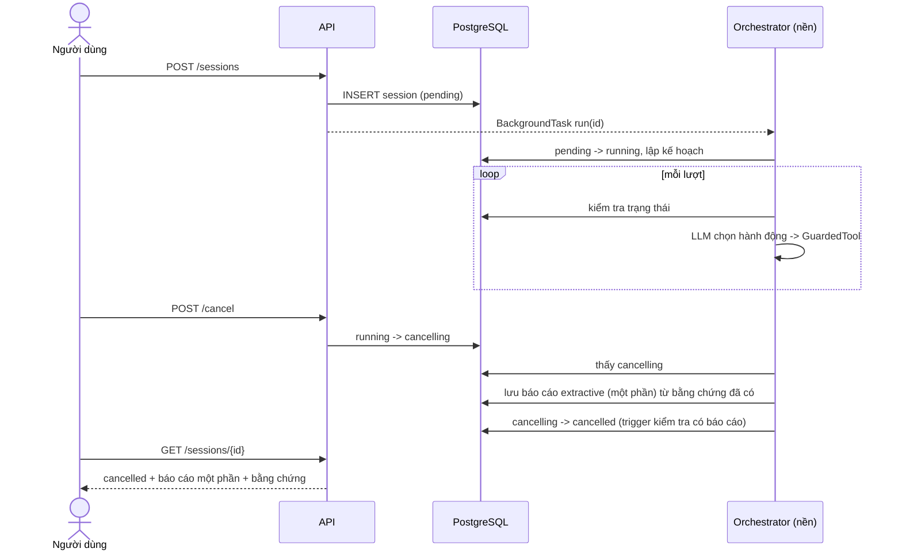

# 04 · Kiến trúc

## Nguyên tắc
1. **CSDL là người gác cổng cuối**: kể cả mã ứng dụng sai, trigger vẫn từ chối chuyển trạng thái sai, ghi bằng chứng sau khi đóng, báo cáo thiếu hoặc trích dẫn không tồn tại.
2. **Chỉ-đọc theo cấu trúc**: công cụ chỉ có pool `aik08_reader`; không có đường tới câu lệnh ghi.
3. **Dữ liệu lấy về là không đáng tin**: quét, gắn cờ, ẩn khỏi prompt, vô hiệu hóa `[E#]` giả.
4. **Fail-closed**: LLM tổng hợp/kiểm chứng lỗi hoặc không đạt ⇒ báo cáo trích xuất; không bao giờ không có báo cáo.

## Luồng một lượt
`_one_step`: LLM đề xuất hành động → `GuardedTool.validate` (allowlist + tham số) → nếu hợp lệ ghi bước `running` → công cụ chạy → quét → bước `executed` → lưu bằng chứng. Hành động sai/trùng được ghi thành dòng **đã đóng**; 3 vi phạm liên tiếp ⇒ `policy_violations`. Bước chỉ bị tính ngân sách **một lần** (trước đây bị tính đôi).

## Hủy và phục hồi

- Phiên `pending` bị hủy chuyển `pending→running→cancelling` trong một giao dịch; tác vụ nền thấy `cancelling` và gọi `recover`.
- `SessionRecovery` đóng phiên mồ côi (quá hạn theo `ORPHAN_GRACE_SECONDS`, và bắt buộc khi khởi động nếu `RECOVER_ON_START=true`).
- Lời gọi LLM nhận `timeout_seconds` = thời gian còn lại; thời gian tối thiểu cho tổng hợp (`MIN_SYNTHESIS_SECONDS`) được giữ lại, nếu không đủ thì bỏ lời gọi tổng hợp.

## Quan sát (OpenTelemetry)
Span: `agent.session` › `planner.plan`, `orchestrator.iteration` › `guarded_tool.call` (thuộc tính `decision`: allowed/blocked/invalid_arguments/duplicate) › `tool.execute`, `injection_guard.scan`, `evidence.append`; `llm.complete` (purpose, token); `report.synthesize`, `rag.verify`. Xuất qua OTLP tới Jaeger (profile `tracing`).

## Tìm kiếm
FTS không dấu (`fold_vi`) + pgvector (băm từ 256 chiều, chạy offline). Từ dừng được lọc **trước khi bỏ dấu** (để "sao lưu", "báo cáo" không bị xóa nhầm), và tài liệu phải chứa ≥60% từ khóa (1–2 từ: đủ cả) để tránh nhồi nguồn không liên quan.
