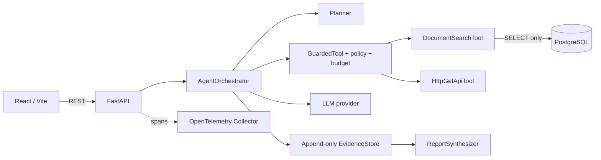

# Kiến trúc

## Request flow

1. `POST /api/sessions` validates the question and caps requested limits at configured defaults.
2. The orchestrator asks the provider for a 3–6 step plan and a proposed tool action for each step.
3. `GuardedTool` enforces the allowlist, checks step/token/time budgets, flags suspicious returned text, and appends evidence.
4. The synthesizer receives evidence as untrusted input and validates that citations refer to stored evidence IDs.
5. `GET /api/sessions/{id}` returns live progress, evidence, and the full or partial report. Cancellation sets a cooperative cancel token.

Sessions and evidence are process-local in this scaffold. Production deployment must provide persistent storage, authentication, authorization, rate limits, and coordinated cancellation across workers.
